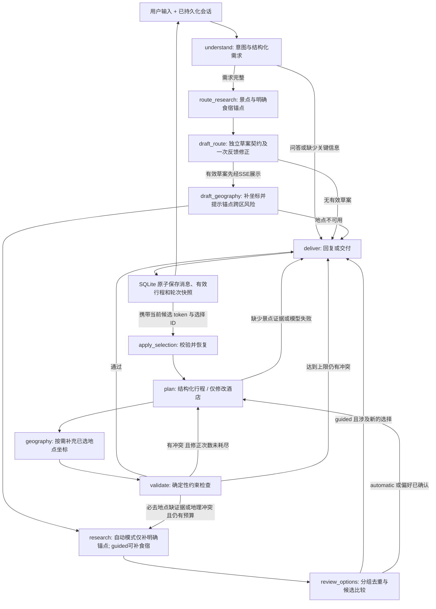

# 旅迹：从单向生成走向可检查的规划闭环

## 先理解系统的定位

这是一个受约束的规划 Agent：模型决定如何理解需求、搜索什么主题、哪些证据需要刷新、如何安排活动；程序负责工具预算、数据契约、验收条件和终止。它用 LangGraph 组合语义决策与确定性步骤，没有把每个函数都包装成一个自治 Agent。

原有 `nodes.py` 的三个 ReAct 子代理保留为学习和回归基线，生产入口 `workflow.py` 使用 `pipeline.py`、`drafts.py`、`anchors.py`、`research.py`、`geography.py` 和 `validation.py`。理解当前系统应从后者开始。

## 主流程

典型闭环不是“让模型再想想”，而是：`budget_exceeded` → 携带结构化反馈重新规划 → 重新计算四项费用 → 通过后才交付。地点缺失时则允许一次补充检索，而非要求模型凭记忆补全。

## 各层的输入与输出

| 层 | 输入 | 输出 | 不交给模型的责任 |
| --- | --- | --- | --- |
| 理解 | 近期对话、既有需求、上海时区日期 | `RequestDecision`、`Requirements` | 缺失日期与日期区间检查 |
| 检索 | 查询主题、刷新类别、已有证据 | `Evidence[]`、工具事件 | 限速、重试次数、调用总预算、类型过滤 |
| 规划 | 用户约束、证据、旧版本、校验反馈 | `Itinerary` 或 `HotelRevision` | Pydantic 验证与字段范围 |
| 地理补全 | 实际被选中的 POI ID | 有来源的坐标 | ID 对应关系、坐标范围、物理调用计数 |
| 校验 | 结构化行程、需求和证据 | `ValidationReport` | 验收标准、是否继续修正 |
| 渲染 | 已通过校验的结构化结果 | Markdown、卡片数据 | 按证据 ID 解析地点名 |
| 持久化 | 一个完整轮次 | 会话、消息、有效行程、JSON 快照 | 原子提交、失败反馈、进程内会话锁 |

## 状态为什么要这样分

- `requirements`：当前用户目标。预算、日期、必去地点是可检查的约束，其他自然语言偏好仍依赖模型理解。
- `evidence`：检索事实，包含来源、城市、时间、分类和稳定引用 ID。与模型描述分开保存。
- `route_draft`：独立的每日主要活动草案，含版本、需求指纹、证据、风险和未核验事项。它没有虚构的酒店、餐厅、时间或价格，不进入正式Trip。
- `preferred_options` / `selected_options`：软偏好和必须执行的选择，分别处理。
- `itinerary`：本轮候选，可能未通过验收。
- `accepted_plan`：最近一次通过检查的版本。失败的修改不能把这个版本覆盖掉。
- `validation`：失败代码、警告、已检查与无法核验的项目。未覆盖未来旅行日期的天气不会伪装成当天预报。
- `trace` / `metrics`：本轮执行事件与调用次数、token 用量、耗时。它们记录可观察事实，不展示模型隐藏推理。

同城明确酒店／必去餐厅是保留式合并：理解模型漏字段不能取消旧义务。`anchor_changes` 需要本轮连续原文及对应取消／指定动作，程序验证后才解除或替换；明确另一次新旅行可用有原文依据的 `anchor_reset_quote`，换城市重置。保守文本门槛无法涵盖任意口语表达，复杂变更需用户重新表述，不宣称中文意图识别已完全可靠。预约仅保留地点与提醒，尚未结构化校验时刻。

同一个会话内，预算和偏好会继续存在；换城市会重新收集证据。天气证据有效期为 1 小时，地点为 6 小时。单纯调整节奏可以复用地点，改变饮食或住宿条件则由主控决定刷新对应类别。

## Human-in-the-loop：把主观偏好交还给用户

默认入口使用 `route_first + automatic`：先形成并展示每日活动草案，自动完成带有自由用餐时段和住宿建议区域的正式计划。普通食宿在交付后按需检索，不触发选择暂停。显式guided仍保留原集中选择兼容路径。明确已订酒店／必去餐厅例外，先定位其证据，参与草案选择。草案采用独立 `RouteDraft`，引用／日期／数量不合法时携实际反馈最多修正一次，仍不合法则停止；无效草案不先展示。正常主流程比旧版增加一次草案模型调用，等待成本用 `time_to_draft_ms` 和模型／工具实际计数记录。不是每个工具都要审批；改节奏时复用已确认的偏好，仅换酒店时重新确认住宿。按钮也支持一键交给 Agent 自动决定，批量冒烟脚本显式使用 `automatic`。

主控在同一次需求理解中给出最多两个住宿方向和三个餐饮查询，不增加一个专门“思考多样性”的模型调用。检索后按方向轮流取候选，并合并名称相同的分店，展示最多四个住宿、六个餐饮选项。住宿按明确的名称信号区分酒店与民宿；这是启发式筛选，不能据此声称已核实等级、价格或房态。

真实试用发现：搜索“西湖周边经济型酒店”也会返回大量民宿；只增加查询次数仍然可能得到相似选项。因此在住宿结果截断前做类型方向筛选，空结果允许在既有两次调用预算内扩大区域；餐饮查询则尽量使用具体菜品或品类，避免“特色面馆／本地小吃”最终都搜出面馆。

暂停不是一个长期挂起的 HTTP 请求：`review_options` 产生 `pending_choice`，经过 `deliver` 返回 `awaiting_choice`，连同候选 ID、随机 token、原规划意图与需求一起原子保存。等待期间没有后台推理循环；刷新或新进程仍可从会话详情取得待选择项。

提交 `ChoiceSelection` 后，在会话锁内检查 token、候选归属、类别、重复项、六小时有效期，以及草案版本与规范化需求指纹，再进入 `apply_selection → plan`。它跳过需求理解，不重复已完成的初始候选检索，仍可按需补充坐标或修复证据。旧 token 或重复提交会被拒绝，不触发额外模型／工具调用。需要换一批时重新检索并产生新 token，旧页面不能继续提交旧候选。

新候选选择分三种：`prefer` 只进入软偏好，模型可按路线预算调整；`automatic` 放开该类别选择；`lock` 才是程序硬约束。lock时规划和校验只允许选择后的住宿及餐厅池。餐厅允许选 1–3 家，不要求每家都必须使用。如果地理校验发现冲突，增补附近候选后再次回到选择节点，不能无声替换。事实证据与待选列表分开处理：空间修复不会删除原证据，附近结果为空也不意味着用户选项失效；选中的有效候选优先保留在比较列表中。价格和营业信息尚未核实，用户点选也不等同于真实预订。

已确认的证据在之后的轮次中若过期、重新检索后不再返回，也会重新打开受影响类别的选择。没有替代候选时停止并解释原因，不把“已选项从证据里消失”误当成用户取消了该约束。校验执行记录保留每轮的具体问题，供复查修正依据。

该实现是**基于轮次快照的业务暂停／恢复**，并非框架内部任意节点断点恢复。尤其“只换酒店”跨请求恢复时，必须从 `accepted_plan` 重建旧日程、从待选择项恢复原意图，避免中途普通聊天或进程重启把局部更新误变为完整重排。对应回归见 `test_human_choices.py`。

## 何时问用户，何时自主行动

目的地、日期区间是生成日程所需的关键输入。缺失时先澄清，不把“没说日期”解释为“今天出发”。已经明确 N 天时，只要给出开始日期即可计算返程日。

预算是可选条件；未提供时仍可生成费用估算，但不宣称满足某个隐含预算。参数范围、日期冲突会直接反馈；不靠模型把这些错误“解释合理”。

模型负责语义提取，因此仍可能误读模糊表达。应通过新的真实对话案例扩充测试，而不是把所有中文需求都写成正则规则。

## 地理校验是实际核查后补出来的

浏览器试用发现：杭州博物馆附近的午餐被安排到临安，模型在说明里承认“较远”，但仍交付。这说明“有来源的地点”不足以证明“可执行的行程”。

文本搜索往往不返回坐标，因此新增 `maps_search_detail`，只补充已选地点坐标。复查同一案例检测到两段约 42 km 的直线绕行，触发 `long_transfer`，随后携带反馈重新规划。详情查询还暴露高德 QPS 限制，因此客户端加入共享节流，限流错误允许有限重试。

当前规则：景点到景点与涉及餐厅的跨区冲突使用不同错误代码。30km以上相邻活动若留白小于`ceil(km/25*60)+15`分钟则要求修正；足够留白仍提示导航未核实。景点错误回到活动规划，不导向餐厅重选。酒店至当日首末景点超过30km只做包含日期、地点和距离的通勤风险提示，保留用户指定住宿。一般相邻活动交通至少留15分钟，同一来源参照点的自由用餐免虚构交通。**这是地理合理性筛查，不是真实导航、路况或公共交通时刻校验。** 缺坐标时明确标记为未核验，不把这项算作“检查通过”。原始失败案例见 `geography-regression.json`。

只有反复修改排序并不能解决候选地点本身太远的问题。第二轮研究会围绕所选景点的坐标调用 `maps_around_search`，替换远距离餐厅／酒店候选，再规划和复查。浏览器真实回归见 `browser-repair-report.json`：首次发现约 42 km 绕行，补充附近餐厅检索后，通过复查；整轮一次修正、12 次工具调用、约 157 秒。

## 局部修改与状态恢复

“只换酒店”使用单独的 `HotelRevision` 契约，只允许输出酒店引用、住宿估算和估算依据。程序合并回原行程，所以每日活动、餐饮、交通和门票费用不会被该分支改动。若日期或城市也改变，则进入完整行程修改分支。

节奏修改仍需模型重新排日程，但复用新鲜证据；这是受影响范围的优化，不等同于所有字段都做了最小差异编辑。

普通问答也接收 `accepted_plan` 的地点名称、日期、估算费用和未核实事项摘要。失败修改后的当前需求不能冒充最近保存的有效方案；问答不会重新发布或覆盖该行程。重新打开历史会话时，检查面板明确展示“已保存行程的执行记录”，避免把旧规划的耗时和工具次数误当成最近一句聊天的指标。

会话采用**轮次级快照**：完成一轮后，消息、有效行程和状态在同一个 SQLite 事务内保存；新进程从 JSON 快照恢复。它不是 LangGraph 中间节点断点续跑，正在执行的轮次若断开连接会取消，不能承诺从某个工具调用中途恢复。

同会话请求用进程内锁串行化，不同会话可以并发；MCP 调用共享限速。多 worker 部署需要分布式锁、持久化图检查点和请求幂等机制，当前仅定位本地单进程学习与展示。

## 终止条件与故障处理

- 每个检索任务最多两次物理调用；配置错误、工具不存在等永久故障不重试。
- 每个选中 POI 的详情查询最多两次，重试也计入同一总预算。
- 默认每轮最多 24 次工具调用。模型 JSON 纠正和短暂连接／超时／429／5xx 重试共享最多两次物理调用预算；鉴权错误不重试。新的用户选择是新的一轮，预算重新计数。
- 默认首次规划后最多修正两次，整轮默认 300 秒超时。
- 没有景点证据时停止生成具体地点行程；修正后仍有硬冲突则返回 `needs_revision`，不保存为已完成方案。
- 部分酒店或餐饮数据缺失时可交付有限方案，标记 `degraded`；未核实费用、营业时间等作为明确警告。
- 前端不会在 API 失败后偷偷显示模拟京都行程。

## 如何评价效果

先分开三个层次，避免用一个数字混淆所有质量：

1. 离线行为回归：真实图拓扑搭配确定性模型／工具替身，验证循环、终止、局部修改、恢复和 API 事件。
2. 固定约束评估：`evals/cases.json` 中的合成错误行程检验程序能否发现已知错误；这个通过率不代表模型生成成功率。
3. 真实冒烟：实际模型和高德连续四轮，观察澄清、生成、节奏修改和住宿修改，并保存状态、校验记录、耗时及 token。

结构化引用能阻止主行程中的虚构 POI ID，但模型生成的说明文字、主题、估算依据并未进行全量实体事实核查，不能宣称“零幻觉”。后续应增加事实评测、真实导航与营业时间信息，而不是把演示成功当成可靠性的证明。

设计参考：[LangGraph workflows and agents](https://github.com/langchain-ai/docs/blob/main/src/oss/langgraph/workflows-agents.mdx)。本项目采用其中适合明确验收条件的 evaluator–optimizer 思路，并用程序承担可计算的验收。

## 区域范围与营业标记的前置检查

主控的 `RequestDecision.scope_clarification` 非空时，在任何地图检索前返回需求澄清。北疆等区域或多城市路线不能静默选一个代表城市，再套用单住宿点与市内距离规则。本版仍不支持多住宿点环线、分段交通及真实导航，区域请求需要先确认集中目的地或拆段。

地点名称中明确标注建设中、装修中或停业时，从工具归一化、缓存复用、候选和规划输入中排除；旧选择在恢复前检查。该过滤只排除明确的负面信号，不证明其他地点正在营业。

## 旧状态迁移与跨轮无进展

当前理解节点写入范围策略版本，新候选携带该版本。旧候选没有确认依据时，恢复先返回范围澄清并保留日期和原正式版本；旧候选不含draft_id时明确保留legacy路径，不伪造历史草案；当前版本的有效候选仍直接恢复规划，不重复需求理解。

可用证据之外，用户已选 ID 是独立约束：规划前和验收时都检查类别、城市、时效与可用性，不能通过过滤证据把失效选择降为数据不足警告。自动模式可采用有效替代；某必要类别已知全部不可用时不能省略后宣称完成。

周边检索未获得新事实且路线仍冲突时，pending 保存需求、事实及所选约束的指纹。相同状态重提在任何模型和工具调用前拒绝；换选、放宽选择、调整范围或显式刷新才是新的工作。指纹不因只更新检索时间而失效，避免跨请求反复消耗调用。

详情补全核对同一 POI 身份，并保留已获得的明确停业信号及其来源和时间。无坐标也能承载不可用事实；错误或缺失 ID 的详情不能更新原条目。缺少负面标记不代表核实营业。

明确关闭事实具有独立的来源时间。`fact_time` 在新鲜度与状态合并中统一使用它，避免初次地点检索接近过期时丢掉刚得到的关闭信息。无状态的后续返回不抹掉关闭、不续期；新的明确状态按有效时间更新，旧记录不因到达顺序覆盖新状态，等时矛盾保守处理。普通地点缓存时间与价格等未核验信息不会因此被改写成刚核验。

本批状态与恢复不变量经历五轮双聊天独立反例复验，报告见 `docs/reviews/independent-review-round5-2026-10-24.md`。这不是对自然语言推荐成功率或全面营业覆盖的评估。

## 按需浏览与规划写入分离（2026-10-25）

默认模型输出`service_mode=browse`。`meal_breaks`包含明确时间和同日景点参照，表示自由用餐而非一家虚构餐厅；`stay_anchor_evidence_id`表示建议检索区域。每天仍需安排用餐留白，非返程日仍需住宿预算与区域，时间重叠、跨日伪造参照和明确已订/必去约束仍被检查。返程日不强制安排当晚住宿。

正式计划版本以itinerary、requirements、evidence的规范化内容计算。`POST /conversations/{thread_id}/browse`只接受版本、日期、地点引用和类别，从服务端计划解析坐标；释放会话锁与只读事务后调用地图，返回前再次在锁内核查正式版本。改版或删除后的旧结果不能展示为当前候选。没有模型调用、消息追加或checkpoint/Trip写入。

前端浏览面板按会话、正式版本、日期和地点建立生命周期，切换或重新规划时取消旧请求；图片只来自对应POI返回的可用HTTP(S)地址，未提供与加载失败分别降级。图片不是房型、价格、房态或菜系认证。图片URL不进入文本模型上下文，草案也不重复携带整份evidence给最终规划器；存储的来源事实与展示图片仍保留。

浏览检索每次最多两个方向，缺坐标时最多一次详情补充，均有超时；同城特色方向只决定检索词，不对每家店的菜系作认证。地域相关性和推荐质量仍需真实任务集持续评估。

## 只读地点图片补全（2026-10-25）

`place-images`和规划写入继续分离。请求只携正式版本与evidence_id，服务端从已使用stops/明确hotel解析POI ID及城市；候选池中未被安排的地点不可借此查询。已有源图直接返回，缺图只调用同ID的`maps_search_detail`，不做模糊名称检索；返回前再次检查删除或改版，来源图不写回accepted_plan/Trip，也不进入模型上下文。

图片加载器每事件循环独立：最多1个物理请求、16个唯一待任务、128条完成缓存。相同城市/POI共享任务；成功/无图/暂不可用分别缓存300/60/15秒。单个调用最多等待12秒，物理调用8秒超时。一个loader等待任务取消不影响其他等待者，全部loader等待任务取消或超时后取消后台任务。HTTP断开是否取消处理协程取决于服务器，未取消的处理仍受12秒调用/8秒物理超时限制。这里只限制图片补取；MCP客户端原账号限速仍生效，规划的工具指标不被展示层读取污染。

前端优先现有1–2张照片，无图才在可视区请求，不给自由用餐参照点重复配图；缺图/网络失败显示占位。图片只说明地图源为该POI提供了照片，不认证营业、房态或具体房型。并发去重及缓存是单进程运行语义，多worker部署需另设共享限流策略。

## 抵离可用时段与休息日

`Requirements`显式保存arrival_time/departure_time、arrival_buffer_minutes/departure_buffer_minutes及rest_dates。`graph/schedule.py`用城市抵离时刻和接驳假设计算每天在08:00–21:00内的可用边界，并把跨午夜离开前留白反映到前一天。`drafts.py`和`pipeline.py`给模型相同的daily_schedule；校验器独立重新计算边界，不相信模型自己声明的空日或“已满足”文字。

休息日不得有景点；普通日不可空。明确休息或可用时间少于180分钟的抵离日免除每日必需景点、用餐和住宿区域，但日期完整、全程必须去、已订地点和预算继续检查。没有来源的空日不假造酒店参照，页面与Markdown显示住宿区域待定。

同一行程后续遗漏的时刻和休息要求保留；明确新时刻只更新对应端。取消通过带本轮原文的schedule_releases，否定、疑问、假设保持原要求并澄清。旧需求中新增字段的默认值不改变pending草案hash；实际时窗变化使旧选择过期。接驳分钟是可调整的排程假设，仍需核实实际站点、交通和办理手续时间；预约时刻另属未完成的约束能力。
