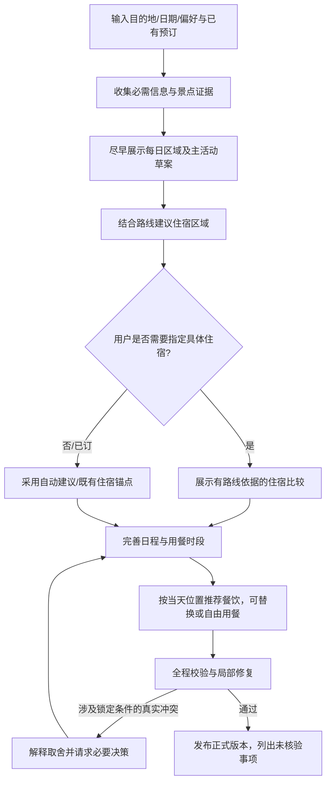

# 旅迹下一版方案：路线草案先出现，食宿按需决策

日期：2026-10-24。用途：作为下一批产品与实现方案，替代“每次先统一选酒店和餐厅再规划”的默认流程。本轮只形成方案，未修改业务代码。

## 1. 当前代码确认与改版目标

当前 `research → review_options → plan` 仍是固定主链，前端固定 guided。已有 SSE 只展示图节点进度，模型 `ainvoke()` 返回完整 JSON 后，用户才能看到完整行程。地点卡片没有照片展示。前三者共同导致：用户先做缺少上下文的选择，之后还要长时间等最终结果。

新版产品承诺：**先帮用户形成可理解的路线，再在影响这条路线的决策点提供食宿建议；用户可以指定，也可以让系统继续。等待过程中持续出现真实、有用的草案内容。**

需要同时改善实际生成时间和等待体验，逐字动画不能替代这两项工作。保留此前五轮验收通过的证据、状态时效、选择恢复和版本保护机制。

## 2. 默认用户旅程

展示草案不是新增一个强制确认步骤。默认让系统继续；用户只有在想控制具体选项或存在必须取舍的冲突时才需要操作。

### 住宿

- 初始只确认“已订／需要推荐／不需要住宿推荐”，可以使用可编辑默认值，避免长问卷。
- 已订酒店优先成为路线锚点，不要求再选酒店。
- 未订时先结合主要活动区域提出住宿区域及取舍，例如“更靠近游览区”与“更方便抵离车站”。没有导航数据时不编造具体通勤分钟数。
- 用户想选具体酒店时，再展示少量候选、路线关系、已知信息和未知信息。提供“自动建议”“暂不指定具体酒店”“我已有酒店”。
- 暂不指定酒店时，路线仍可继续形成，但相关往返交通是基于住宿区域的假设，需要清楚标记。
- 度假酒店旅行、美食旅行等已有明确锚点的场景，依用户目标调整顺序，不机械执行“所有酒店都后选”。

### 餐饮

- 初始收集菜系、忌口和预算偏好，不要求确认全程一至三家餐厅。
- 先在日程中保留午餐／晚餐窗口；按当日活动位置查附近候选。
- 默认建议一家具备证据的合适餐厅，展开后比较少量替代；“换一家”“自由用餐”“稍后再看”都是合法操作。
- 用户点“喜欢”只影响排序；点“必须去／已预约”才成为硬约束。指定餐厅可以反过来影响当日路线。
- 不为每顿饭暂停规划。没有强偏好或真正冲突时系统继续，选择入口嵌在当天行程里。
- “自由用餐”是明确的用餐策略；“稍后指定具体餐厅”是待补充项。二者状态应分开，不能都当成检索失败，也不能把待定项假装已确认。

## 3. 用户实际看到的内容

以“杭州三天，轻松一点，喜欢博物馆和当地菜”为例：

1. **需求摘要先出现**：三天、轻松、博物馆与当地菜；提示是否已订住宿，不挡住已有信息的展示。
2. **每日骨架出现**：第一天西湖周边、第二天老城、第三天按返程时间收尾。只使用已获取证据或明确的区域假设，不提前展示虚构具体门店。
3. **住宿决策嵌入概览**：“按这条路线建议比较两个住宿区域。可以先用区域假设继续，或展开选择具体酒店。”
4. **单日草案逐步完善**：景点、用餐窗口、交通假设；午餐卡片出现餐厅缩略图、选择原因和替换入口。
5. **用户改一顿饭**：该用餐窗口及关联交通更新，其余已锁定安排保留。
6. **正式交付**：全局校验完成后发布；说明营业、预约、价格与导航哪些仍未核验。

桌面建议以路线／行程为主、地图与决策详情为辅；手机按天浏览，点击卡片展开食宿决策。执行次数和 token 收入“执行详情”，普通用户优先看到路线与取舍。

## 4. 渐进输出与实际耗时优化

### 输出三层

| 层次 | 展示内容 | 发布条件 |
| --- | --- | --- |
| 即时反馈 | 请求已接收、需求摘要、当前真实动作 | 有对应实际事件；不编造百分比或倒计时 |
| 草案内容 | 完整的每日区域／单日草案／食宿决策卡片 | 结构完整、引用有效，标清尚未完成的检查 |
| 正式版本 | 全程一致的行程与成本假设 | 完成跨天、预算、锁定事项等全局检查 |

普通聊天与解释可以逐字输出；结构化行程按完整业务对象渐进展示。不能把半截 JSON、内部提示词或模型隐藏推理送入用户界面。

### 实现边界

- 复用已有 SSE，新增需求摘要、节点开始、检索结果、路线骨架、单日草案、待决策、对象替换及正式版本发布等业务事件。
- 节点内部发送自定义事件，避免整个 research／plan 完成前只有等待提示。LangGraph 已区分状态更新、消息和自定义输出，实施需核对项目锁定版本：[官方说明](https://docs.langchain.com/oss/python/langgraph/streaming)。
- 新事件需要 run_id、递增序号、draft_version、稳定对象ID；正式版和草案分开保存。修复必须能替换／失效旧对象，避免旧卡片继续显示。
- 真正提前显示日程，需拆出较小的路线骨架，或从模型增量结果中提取完整对象后校验；仅在前端打字展示最终文本不能缩短首次有用内容时间。
- 不默认每一天各加一次模型调用。先评估骨架与细节拆分、增量解析的调用成本及总耗时；独立检索仅在共享QPS、预算约束下有界并发。
- 用户选定某家酒店／某顿饭后，优先修复受影响对象，再跑全局检查，不重新生成整份方案。
- 照片、装饰文案和非关键详情异步加载，不阻塞路线或决策卡片；不为了生成“正在做什么”的文案增加模型调用。
- 当前执行断连会取消、候选等待可持久化。第一版继续使用已验证的业务暂停／恢复，不宣称已有后台长任务或任意节点断点恢复。

## 5. 图片不是单纯装饰，应服务于决策

| 位置 | 图片目的 | 要求 |
| --- | --- | --- |
| 城市／每日路线概览 | 建立目的地印象 | 可使用有来源的城市／区域图，不能冒充某家酒店实景 |
| 景点卡片 | 帮用户判断体验类型和兴趣 | 优先同POI实景；没有图时保留清晰文字 |
| 酒店比较 | 比较门店环境 | 外观／大堂／房型需标明类型；普通门店照不能当作本次可订房型 |
| 餐饮卡片 | 辨别店面或菜品 | 区分门店实景与菜品示意；同名分店不能混图 |
| 路线地图 | 判断位置与顺路程度 | 与当天地点联动；未接导航时不把连线说成真实步行路线 |

高德地点搜索文档列有 photos 信息，可以优先核实当前MCP返回、账号接口权限及图片展示条件，再决定是否通过现有详情或独立Web服务取图：[官方文档](https://lbs.amap.com/api/webservice/guide/api/search/)。文档支持该字段，不代表当前项目的MCP已经返回或允许所有图片用途。

当前 `_normalize_poi` 和前端类型／卡片没有图片链路。需要新增独立媒体对象：POI ID、URL、来源、图片用途／说明、获取时间及适用的展示／署名信息。图片不进入模型长上下文，不作为价格、营业或房态证据。

匹配失败、无图片或图片加载失败时使用中性占位和文字，不生成假的实景来填充真实酒店／餐厅卡片。第一版每卡一张缩略图、固定比例、懒加载，展开再看更多；图片区加载不应把等待变得更长。

## 6. 架构与领域契约的最小调整

现有 Itinerary／Stop 强制具体地点引用，不能直接承担所有草案、自由用餐和暂定住宿。因此新增草案契约，并明确升级现有交付规则，而非简单绕过校验。

| 对象 | 关键含义 |
| --- | --- |
| PlanDraft | 每日区域与候选安排、版本、已完成／待完成检查；不冒充accepted_plan |
| MealSlot | 所属日期、时间窗口、位置锚点、自动推荐／自由用餐／待定／已预约状态 |
| LodgingNeed | 已订、需要建议、不需要推荐，以及住宿区域假设或指定POI |
| UserConstraint | 软偏好、收藏、必去、已订与锁定分开；说明适用对象和范围 |
| PendingDecision | 决策类型、目标对象ID、候选、base_version、token、允许操作和影响范围 |
| PlaceMedia | 图片与准确POI绑定，附来源和用途，不混入事实可用性时间 |

统一的 pending_choice 扩展为有目标范围的决策：例如只为11月某日午餐选店，不再解释为全程餐厅白名单。恢复时校验token、候选归属、当前版本和有效证据，过期决策不能修改新草案。

允许“自由用餐”后，对应校验检查用餐时间与预算预留，不要求虚构餐厅引用；有明确已预约餐厅仍检查其地点与时间。允许暂定住宿区域后，正式交付需要明示住宿未落实和路线假设，不能套用现有“具体酒店必选”规则，也不能把它等同已预订。

图由固定“先统一选食宿”改为业务状态驱动：先形成路线骨架，检查哪些决策真正影响后续，再进入对应决策／完善分支。修改后的反馈Loop优先局部修复，只有涉及锁定事项或真实不可行取舍才暂停。无需更换LangGraph或增加多个自治Agent。

## 7. 分批交付与验收

| 批次 | 交付 | 验收重点 |
| --- | --- | --- |
| A：先解决首次价值 | 不再统一前置食宿必选；新增路线草案与草案事件；支持已有住宿／暂不指定 | 不选具体食宿也能看见有来源的路线骨架；草案不会覆盖原正式版 |
| B：在路线中决策 | 按天／按餐的选择与自由用餐；住宿区域比较；目标对象局部修改 | 只换某顿饭不限制全程餐厅，不改无关锁定内容；旧token／旧版本拒绝 |
| C：补充视觉与性能 | POI图片、地图联动、图片懒加载、检索与模型耗时优化 | 图片准确对应地点且不阻塞草案；没有图片也能完成规划 |

图片获取能力可与A批并行准备，但不要把图片供应商接入变成路线流程上线的前置依赖。

保留前五轮通过的事实时效、已知关闭、跨检索保留、显式状态更新、范围策略、无进展指纹、恢复与正式版本隔离用例。新流程特别加入：

- 已订酒店用户不再被要求选酒店；美食／度假酒店作为锚点仍可正确规划。
- 未选择食宿时持续出现可读草案；选择后只更新相关对象。
- 每天餐饮可分别自动／指定／自由用餐，不强迫绑定全程三家门店。
- 来源已知关闭的选择不能进入新正式版，图片加载成功不改变可用性结论。
- 不完整单日对象不发布；跨天重复、总预算和用户锁定仍在正式交付前全局检查。
- 流中断／恢复、候选过期、连续更换选择不会混用旧草案或覆盖原正式版。

首要衡量“首份有用路线草案时间”“选后首次有用更新时间”“不必要的强制选择次数”“局部修改成功率”，同时记录总耗时、外部调用数和成本。可以设实验目标，但在固定需求集实际测量前不承诺具体秒数或性能提升比例。
