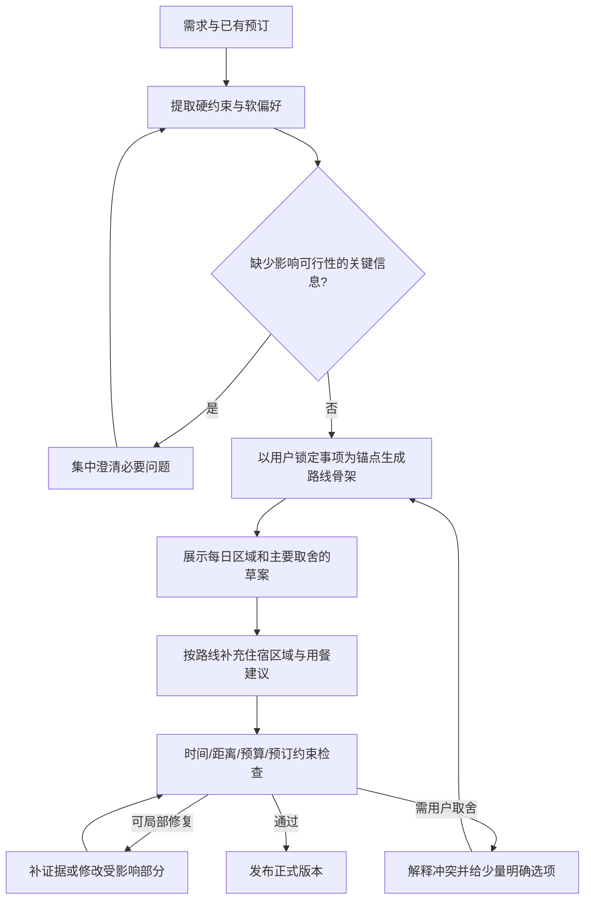

# 旅迹产品与规划流程评审

评审日期：2026-10-24。依据：当前前后端源码、架构说明、仓库中的真实 API 运行记录和保存的界面截图。本次没有重新调用付费模型／地图接口，没有进行新一轮在线端到端测试，也没有真实用户访谈。用户心理和流失风险属于待验证的产品假设；代码行为与历史记录属于可核查事实。业务代码未修改。

## 1. 核心判断

项目已经有可信的工程底座：证据引用、程序校验、有界修正、失败不覆盖有效行程、候选暂停恢复、酒店局部修改。问题主要集中在产品决策顺序和领域模型上。

当前默认过程是“先找住宿餐厅、让用户选具体店，再生成路线，最后检查地理冲突”。用户尚未看见路线和取舍，就承担具体供应商选择；之后系统又可能因路线冲突要求重选。这里存在本可提前避免的返工。

建议把默认产品承诺收敛为：“先给你一份看得懂、顺路且能修改的城市旅行草案，再共同确认重要取舍。”优先服务单城市短途自主旅行；1–14 天可以保留为技术范围，但不应在没有足够质量评估时暗示长行程与两日游同样成熟。

流式输出应该改进，但逐字输出只处理等待感的一部分。真正重要的是更早展示有用草案，以及避免错误的前置决策。

## 2. 用户实际在完成什么任务

以下为产品假设，需要通过访谈和任务测试验证。

| 用户阶段 | 内心问题 | 应当给出的帮助 | 当前主要缺口 |
| --- | --- | --- | --- |
| 探索 | 适合我吗？大概玩什么？ | 主题、区域、强度和粗预算 | 没有明确日期不能进入具体规划，缺少独立的灵感草案路径 |
| 规划 | 怎么安排才不累、不绕路？ | 每日区域、路线图、交通时间、休息留白 | 用户先选陌生店铺；实际交通与体力负担尚未验证 |
| 决策 | 我为什么要选这个？代价是什么？ | 少量可比较方案及具体取舍 | 候选主要是名称、地址、检索方向，缺少路线关系和可验证的差异 |
| 已有安排 | 我已订了酒店，还需要你排景点 | 以既有安排为锚点，保护已订内容 | 缺少结构化的已订住宿、不需要住宿推荐等状态 |
| 临行／途中 | 今天变化了怎么办？ | 当日视图、导航、营业核验、附近替换 | 当前交付主要是计划文档，缺少现场执行入口 |

用户的控制感通常来自“理解推荐原因、随时能改、已确认内容不会乱动”，不能单用“选择次数多”衡量。NN/g 的识别优于回忆原则强调给决策提供上下文；陌生店名列表虽是选项，但仍缺少理解选项所需的信息。[参考](https://www.nngroup.com/articles/recognition-and-recall/)

## 3. 提前选酒店餐厅的问题

### 代码事实

- `Backend/app/graph/workflow.py`：`research → review_options → plan`，默认在规划前比较候选。
- `Frontend/src/api.ts`：前端固定发送 `interaction_mode: "guided"`；用户只能在候选出来后选择自动安排。
- `Backend/app/graph/choices.py`：最多展示四个住宿和六个餐饮候选；手动继续时有对应候选就必须选择。
- `Frontend/src/components/ChoicePanel.tsx`：住宿选一家、餐厅选一至三家；不能单独跳过餐厅，同时手动确认酒店。
- `planner_evidence()`：选中餐厅之外的餐饮证据会被排除。选择表达的是可用餐厅范围，而非收藏或一般喜好。
- `pipeline.py` 与 `validation.py`：有餐厅证据时每天必须安排餐饮；多日且有酒店证据时必须选酒店。

需要准确区分：当前并没有要求用户确认每顿饭，实际是确认一至三家餐厅形成全程候选池。这个池仍然可能过早、过窄，尤其不适合较长行程。

### 为什么用户会为难

1. 不熟悉目的地的人不知道地址与景点是什么关系，无法判断哪个选项更顺路。
2. 酒店缺少真实日期房价、房态、房型、取消条件，不能支撑实际预订选择。
3. 餐厅缺少结合用餐时段的营业信息、绕行成本和价位依据，选择只能依靠店名印象。
4. 用户可能只想“当地菜、别太辣、每餐预算合理”，系统却要求确认具体门店。
5. 用户选定后系统再提示“离景点太远，请重选”，容易让人质疑先前为什么推荐它。

### 建议的分层

| 对象 | 何时问 | 默认表达 | 必须成为硬约束的情形 |
| --- | --- | --- | --- |
| 餐饮偏好 | 初始需求，可选补充 | 菜系、忌口、价格范围 | 明确过敏／禁忌应独立表达并影响筛选；食材安全仍需门店确认 |
| 具体餐厅 | 当日路线基本成立后 | 附近推荐、可收藏、可跳过 | 用户明确表示必须去，或已有预订 |
| 住宿区域 | 结合主要活动区域提出 | 少量区域及交通取舍 | 用户已订酒店时直接以其为锚点 |
| 具体酒店 | 用户需要进一步比较时 | 待核实候选 | 已订或明确锁定；锁定不等于系统证明可订 |
| 用餐时段 | 规划时 | 保留时间，可自由用餐 | 已预约的餐食时间 |

例外：美食旅行可以先以必吃餐厅为锚点；度假酒店旅行可以先以酒店为锚点。问题是“一律前置具体选择”，不能改成“一律后置”。

卡片应解释“为什么推荐、与路线有什么关系、哪些信息还未知”。例如“位于第二天游览区域附近”，在接入导航后再显示有来源的交通时间。缺房价时写“未获取”，不要展示模型生成的伪实时报价。

## 4. 流式输出：已有基础，内容体验仍不完整

### 当前实现

`Backend/app/api/routes.py` 已提供 SSE，包含 `start/progress/result/error` 和保活。`orchestrator.py` 用 `stream_mode=["updates", "values"]` 消费图执行，进度主要在节点完成后产生。

`model_gateway.py` 用 `ainvoke()` 获取完整 JSON，再做 Pydantic 校验。前端 `api.ts` 处理进度和最终结果，`App.tsx` 在完整返回后才追加助手文本和保存行程。因此用户可以看到阶段变化，却看不到逐步形成的行程草案。

检索任务目前串行执行，单次工具结果先进入节点内部 trace；整个检索节点结束后才经节点更新传给前端。长节点期间可能只剩等待和保活。前端还通过静态映射预测下一节点，并非完整的节点开始事件，复杂分支可能出现阶段文案不准确。

### 建议采用三类输出

1. **即时反馈**：请求接收、已识别目的地／日期、当前真实动作。不能伪造百分比或编造完成时间。
2. **阶段性内容**：每日区域骨架、完整的单日草案、住宿区域建议。标明草案和核验范围，后续修订可追踪。
3. **正式版本**：所有相关检查结束后发布；保留此前有效版本，草案不能直接覆盖它。

普通聊天、需求澄清可逐字输出；结构化行程优先按完整业务单元渐进展示。不能把半截 JSON 直接渲染成正式行程。先增加节点内自定义业务事件即可改善观察性；若要在整份计划完成前展示内容，则需增量解析完整对象或拆分骨架与日程生成，不能只改前端文字动画。

LangGraph 官方区分了状态更新、消息和自定义流，现有框架具备对应扩展路径；实施需核对本项目锁定版本与模型服务兼容性，不应直接照搬最新版接口。[官方文档](https://docs.langchain.com/oss/python/langgraph/streaming)

事件建议至少有 `run_id`、递增序号、计划版本、对象 ID、事件类型。草案更新必须有替换／失效语义，防止重连或修复后继续显示旧内容。正式版本发布前检查跨天约束、总预算与全部锁定事项，单日通过不能等同全程通过。

### 已有性能记录的正确解读

| 来源 | 记录 | 含义 |
| --- | --- | --- |
| `human-choice-live-report.json` | 首次候选约18.7秒；选定后约70.2秒 | 两个不同业务轮次，用户决策时间不在内；中间另有一次约13.8秒的换候选 |
| `browser-repair-report.json` | 一次带路线修复的生成约156.7秒 | 修复会明显延长等待，但不能据此计算普遍平均值 |
| `live-smoke-report.json` | 完整生成约78.5秒；节奏修改约27.8秒；酒店修改约15.6秒 | 局部任务有优化基础；均为历史单次样本 |

先记录模型、检索、坐标补全、修复的分段耗时，再定位性能瓶颈。对于独立检索可考虑有界并发，但必须共享现有地图 QPS 限制和工具预算，不能直接全部并发。分日生成也应评估总模型调用、上下文重复及跨天冲突，不能假定拆分就一定更快。

## 5. Loop 的根因和修改方向

现有 Loop 做了正确的事：失败反馈回规划器，必要时补证据，限定修复次数，避免无限调用。无需为了这些问题更换 LangGraph，或增加多个自治 Agent。

根因分为四层：

| 层 | 当前问题 | 主要改法 |
| --- | --- | --- |
| 产品策略 | 低上下文的具体门店选择过早 | 先展示方向与路线，按用户需要展开选择 |
| 状态契约 | 喜好、指定、锁定都落在一个所选 ID 池里 | 分开偏好、收藏、必去、已订和锁定状态 |
| 规划依赖 | 餐饮常与酒店区域共用初始检索位置，路线形成后才发现不合适 | 根据每日活动区域和用餐时段检索，提前过滤明显地理冲突 |
| 修复粒度 | 除酒店外多为整份行程重新生成 | 明确受影响对象，局部补证据、局部修复，再做全局检查 |

建议默认流程：

草案首次展示无需等待用户必须点确认；用户不介入时可以继续完善。仅遇到真实取舍、修改锁定事项或关键条件缺失时暂停，避免把当前一次前置选择变成更多强制步骤。

“无需打扰的修复”包括未锁定的附近餐厅替换、轻微时间调整；“需要告知并选择”的情形包括删除必去点、超预算、换已订酒店、明显增加交通或牺牲重点活动。用户指定餐厅不能被系统悄悄降级为普通偏好。

技术实施可先保留现有图，只替换默认选择门槛和约束表达，再引入路线骨架、日程内容事件和局部修复；后续视复杂度拆子图。无需一次重写全栈。

## 6. 其他影响真实使用的功能缺口

### 需求表达不够完整

`Requirements` 目前没有结构化的抵达／离开时刻、进出站点、交通方式、每日步行承受量、成人儿童及房间数、已有住宿、是否需要推荐住宿等字段。模型可能理解 preferences 中的自然语言，但下游不能稳定验收这些条件。

首轮只问影响可行性的关键信息，例如首末日可用时间、是否已订酒店；其他条件使用可编辑默认值并渐进展开，不能做成长问卷。对未确定日期的探索用户，提供独立的示意方案，不能假造准确日期或天气。

### 验收标准过于刚性

`validation.py` 当前要求每天至少一个景点、08:00–21:00、每项至少30分钟、存在餐厅证据就每天安排餐厅。它会限制晚间抵达、返程日、休息日、夜游、随便吃点等合理行为。

建议增加 `day_type`、首末日可用时窗、自由用餐和休息时段。夜游需要符合已知营业／活动时间和用户偏好，不宜把全局限制简单取消。对不同场景应用不同规则。

“两天”不应自动等价于“必须由系统推荐酒店”：住朋友家、已有预订、不需要推荐均是有效状态。已有酒店仍需计入相关预算语义，但要区分“旅行总成本”和“还需支付金额”。

### 路线检查还不能证明顺路

当前用直线距离、30公里阈值和约25公里／小时的换算做粗筛。短距离也可能因绕路、换乘和堵车耗时很长；30公里以内不代表轻松。酒店检查主要对当日首末景点，并非完整的每日往返交通验算。

建议增加交通方式和路线边 `TravelLeg`，使用导航返回的距离／预计时间，计算全日交通、步行、活动与休息负担。高德已有驾车、公交和步行路径规划接口，是否通过现有 MCP 暴露、当前账号权限与配额需实施时核实。[官方文档](https://lbs.amap.com/api/webservice/guide/api/direction)

### 预算检查存在能力边界

当前比较的是模型提供的四项估算总和与预算；公式可以通过，但金额未必有真实价格支持。调低估算金额也可能让数字满足预算，却不改变方案的实际可负担性。这是机制风险，并非本次已证实模型发生了虚假压价。

建议用数量、单价区间、房间数、晚数、来源和时间拆分成本项。暂无价格源时，明确为预算假设而非实际可订报价。预算太低时给出可解释的取舍；不把降低估算数字作为修复成功。

### 成果展示与修改能力偏弱

当前 `TravelPlan.tsx` 主要为纵向日程、酒店与费用；缺少全路线地图、交通段、局部替换和版本撤销入口。可先提供“一张地图＋按天筛选”，再增加“换这顿饭、删除此景点、锁定此项、第二天轻松些”。按钮应绑定稳定对象 ID，避免全靠自然语言定位。

酒店局部修改的 `HotelRevision` 已证明保护修改范围有可行基础。对餐厅、单天和单项活动可使用类似的明确变更契约；修改后仍检查全局重复景点、预算和锁定约束。

普通用户默认优先看路线、费用假设和待确认事项；工具次数、token、模型调用放入可展开详情。展示项目可保留独立演示模式，不必删除工程观察能力。

### 可靠性表达要更具体

“校验通过”应对应清楚的检查范围，例如“日期与时间冲突检查通过；营业、预约、导航尚未核实”。当前警告主要在执行面板和完整文档，卡片模式应在相关对象附近展示关键未核验信息。

规则中的 `unverified_checks` 目前只显式收录缺坐标和天气覆盖，实时价格／营业／导航主要通过警告表达。建议统一各项状态为通过、冲突、未核验、不适用，避免用户把整体绿勾理解成全部可执行。

### 等待与恢复需要匹配承诺

候选等待可恢复，是已有能力；执行中的轮次不能任意节点恢复，SSE 断开会取消对应任务。对于长任务，后续可增加独立任务 ID、查询与重连、持久化检查点、请求幂等和显式取消。不能只增加前端重试，避免重复模型调用。

鉴权和多租户隔离属于公开上线前的门槛。当前本地展示阶段应优先验证规划体验，无需用平台化改造替代核心产品改进。

## 7. 建议的实施顺序与验收

| 优先级 | 交付内容 | 验收任务 |
| --- | --- | --- |
| P0 | 默认先出路线草案；住宿餐饮可分别跳过；偏好与锁定分离 | 未选择具体店铺也能拿到草案；已有酒店成为锚点；明确指定餐厅得到保留 |
| P0 | 抵离时刻、已订住宿、自由用餐／休息状态及对应规则 | 晚上抵达不排白天景点；休息日不会因没有景点失败；不需要酒店推荐不会被阻断 |
| P0 | 真实阶段事件、草案／正式版本区分、核验范围展示 | 检索节点内部有真实反馈；失败草案不覆盖有效版本；正式发布前检查全程约束 |
| P1 | 地图与交通段，按每日路线搜索餐厅／住宿区域 | 用户无需逐店外跳即可判断路线关系；有数据的交通显示来源，无数据明确未知 |
| P1 | 单餐／单项／单日修改、差异预览和撤销 | 换午餐时锁定景点不变；删除景点后仅合理调整关联时段；全局约束仍有效 |
| P1 | 预算明细与可行性解释 | 显示人数、房间、晚数及估算依据；预算不足给取舍，不靠降低无依据金额通过 |
| P2 | 任务重连与持久化执行恢复 | 断网重连不会重复创建任务；恢复状态与正式版本一致 |
| P2 | 同行协作、预订聚合、多城市 | 核心单城体验验证后再按研究结果扩展；多城市需独立的分段交通和多住宿模型 |

不建议把“增加多 Agent、支持全国多城市、接更多预订平台”作为首轮目标。这些会扩大复杂度，当前最明显的价值缺口在首次产出、决策上下文和可执行性。

## 8. 如何验证判断

固定任务集至少覆盖：首次去杭州、已有酒店的两日游、带老人少走路、晚间抵达与中午返程、有必吃餐厅的美食游、包含休息日、预算明显不足、修改午餐但保留景点、区域游超出支持范围。

先邀请约5–8名符合目标人群的用户完成任务，用于发现定性问题，不能用这类样本量宣称总体转化率提升。观察用户在哪一步开始查外部信息、何时犹豫、是否明白选项后果、是否能够独立完成一次局部修改。

建议指标：

- 首个有用草案时间：首次出现包含每日区域／主活动／交通假设的可读内容，区别于首个 token 和进度提示。
- 候选阶段退出率、完成草案所需的强制决策次数。
- 因地理冲突导致的再次选择次数、无依据重复整份生成次数。
- 局部修改成功率：指定对象已改，不受影响的锁定事项保持不变，全局检查仍通过。
- 用户能否解释为什么推荐当前路线／住宿区域，以及哪些信息还未核实。
- 真实可行性样本审查：营业与预约、交通时长、预算依据、首末日和体力限制。
- 同一固定任务多次运行的成功率、延时分布和成本；报告 P50/P95 前先具备足够样本。

可以将“更早看到可理解草案、减少不必要选择、修改更可控”作为新流程的实验目标；不预设未经测量的提升比例或保证达到某个生成秒数。

最终产品原则：系统承担组合与筛选工作，用户决定真正重要的偏好与取舍；输出越早，草案和正式版本的边界就越需要清楚。
